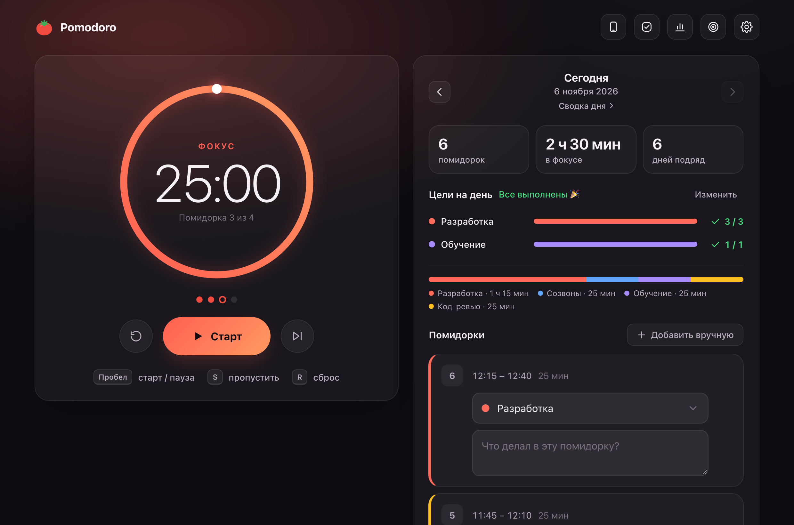

# Pomodoro

Помодоро-таймер и личный трекер для macOS: помидорки с категориями и описаниями, цели на день, привычки, статистика и **экранное время iPhone** — всё в одном месте и только на твоём компьютере.

Приложение — это маленький локальный сервер (один файл, написан на Go) с веб-интерфейсом. Двойной клик по `Pomodoro.app` поднимает его на `127.0.0.1` и открывает вкладку в браузере. В интернет ничего не уходит (кроме необязательной загрузки иконок приложений из App Store, см. ниже).



## Возможности

- **Таймер** — фокус, короткий и длинный перерыв, настраиваемые длительности и число помидорок в раунде, автостарт, звуковой сигнал и системное уведомление. Таймер переживает перезагрузку страницы.
- **Журнал за день** — каждая помидорка попадает в список: категорию можно выбрать или сразу вписать новую, добавить описание. Пропущенная (но начатая) помидорка засчитывается с фактическим временем. Можно добавить помидорку вручную.
- **Цели на день** — например «Разработка — 3 помидорки, Обучение — 1». Прогресс виден на главном экране.
- **Привычки** — отмечаешь «сделал сегодня», видно серию дней подряд. Можно отмечать и прошлые дни.
- **Статистика** — день, 7 дней, 30 дней, год: графики по дням и категориям, тепловая карта за год, привычки, телефон.
- **Сводка дня** — всё за выбранный день на одной странице: лента «как прошёл день» (помидорки и телефон по часам), цели, привычки, помидорки, приложения iPhone.
- **Экранное время iPhone** — время по приложениям и категориям за день и неделю, график по часам, история каждого приложения, сравнение с обычным днём.
- **Часовой пояс приложения** — можно жить по одному поясу, даже если на Маке стоит другой.
- Экспорт в JSON и CSV, ежедневные резервные копии.

## Требования

- macOS 11 или новее (Apple Silicon или Intel)
- [Go](https://go.dev/dl/) 1.25+ — нужен только для сборки: `brew install go`
- Любой браузер

## Установка

```bash
git clone https://github.com/andrnog/pomodoro.git
cd pomodoro
./release.sh
```

`release.sh` собирает приложение, кладёт его в `/Applications/Pomodoro.app` и запускает. Дальше открывай Pomodoro из «Программ», Launchpad или Spotlight — откроется вкладка `http://127.0.0.1:47321`.

Если не хочешь ставить в «Программы», можно просто собрать и запустить:

```bash
./build.sh prod
open build/Pomodoro.app
```

**Как остановить:** настройки (шестерёнка) → «Остановить сервер». Повторный запуск приложения, пока оно уже работает, просто откроет вкладку.

## Как пользоваться

| Где | Что |
|---|---|
| Таймер | «Старт» или `Пробел` — запустить/пауза, `S` — пропустить, `R` — сбросить |
| Карточка «Сегодня» | завершённые помидорки: выбери категорию (или впиши новую и нажми Enter) и опиши, что делал. «Сводка дня» — подробности за день |
| 📱 Экранное время | время в приложениях iPhone (настройка ниже) |
| ☑️ Привычки | добавить привычку и отметить за сегодня или прошлые дни |
| 📊 Статистика | периоды, графики; клик по любому дню открывает его сводку |
| 🎯 Цели | сколько помидорок по каким категориям нужно за день — одни цели на все дни |
| ⚙️ Настройки | длительности, автостарт, уведомления, часовой пояс, категории, экспорт, папка с данными |

## Экранное время iPhone (необязательно)

У Apple нет открытого API для экранного времени, поэтому Pomodoro читает журнал, который macOS сама синхронизирует с iPhone (хранилище Biome: «какое приложение было на экране и когда»).

1. **На iPhone:** Настройки → Экранное время → включи **«Учитывать на всех устройствах»** (Share Across Devices). iPhone и Мак должны быть в одном Apple ID.
2. **Сертификат подписи (один раз):**
   ```bash
   ./tools/make-cert.sh
   ./release.sh
   ```
   Без него macOS будет сбрасывать доступ из пункта 3 после каждой пересборки.
3. **На Маке:** System Settings → Privacy & Security → **Full Disk Access** → `+` → выбери `/Applications/Pomodoro.app` и включи переключатель.
4. Перезапусти Pomodoro (настройки → «Остановить сервер», потом снова открой приложение).

Что важно знать:
- Считается время, когда приложение **открыто на экране**. Видео под опущенной шторкой, в маленьком окне или в фоне в этот журнал не попадает — YouTube и музыка могут показывать меньше, чем «Экранное время» на телефоне. Остальное совпадает с iPhone до минуты.
- iPhone присылает данные на Мак через iCloud с задержкой — от пары минут до часа, это решает iOS.
- macOS хранит этот журнал около месяца; Pomodoro сохраняет посчитанные дни у себя, так что история не пропадает.
- Названия и иконки приложений подтягиваются из App Store: в Apple отправляются только идентификаторы приложений (вроде `com.burbn.instagram`). Это можно выключить внизу окна «Экранное время».
- Формат журнала не документирован Apple и может измениться с обновлением macOS.

## Данные

Всё хранится локально:

```
~/Library/Application Support/Pomodoro/
├── data.json          — помидорки, категории, цели, привычки, настройки
├── screentime.json    — экранное время по дням
├── icons/             — иконки приложений
└── backups/           — копии данных за каждый день (последние 60 дней)
```

Перед каждым обновлением через `release.sh` делается ещё одна копия в `backups/release-<дата>`.

## Разработка

Чтобы экспериментировать, не трогая свои данные, есть отдельная версия для разработки:

```bash
./build.sh                       # build/Pomodoro Dev.app
open "build/Pomodoro Dev.app"    # порт 47322, данные в ~/Library/Application Support/Pomodoro Dev
```

У неё синяя иконка и значок **DEV** в интерфейсе. Когда всё готово — `./release.sh` выпускает рабочую версию.

Полезное:
- `POMODORO_ADDR=127.0.0.1:48000` — другой адрес, если порт занят;
- `POMODORO_DATA_DIR=/путь` — другая папка с данными;
- `pomodoro --no-browser` — запуск без открытия вкладки.

Структура:

```
main.go          — HTTP-сервер, хранение данных, резервные копии
screentime.go    — чтение журнала iPhone (Biome/SEGB), подсчёт по дням, App Store lookup
web/             — интерфейс (HTML, CSS, JS без сборщиков и зависимостей)
web/tz.js        — часовой пояс приложения
tools/icon       — генератор иконки
tools/make-cert.sh — локальный сертификат подписи
build.sh, release.sh
```

## Лицензия

MIT — см. [LICENSE](LICENSE).
